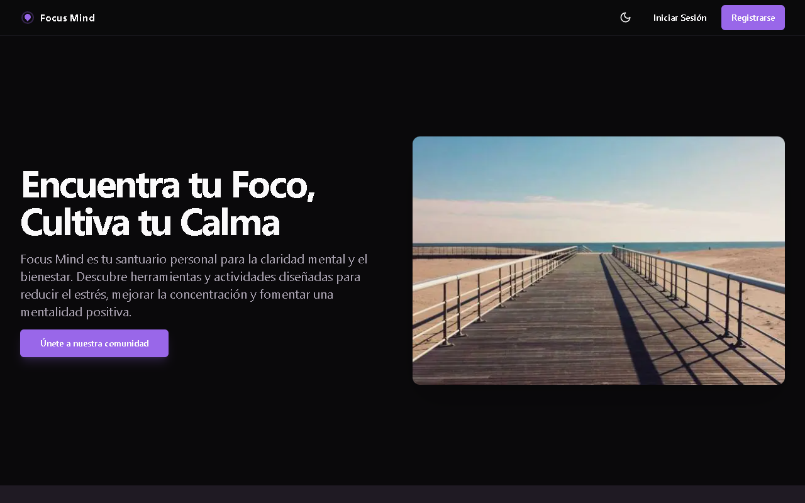
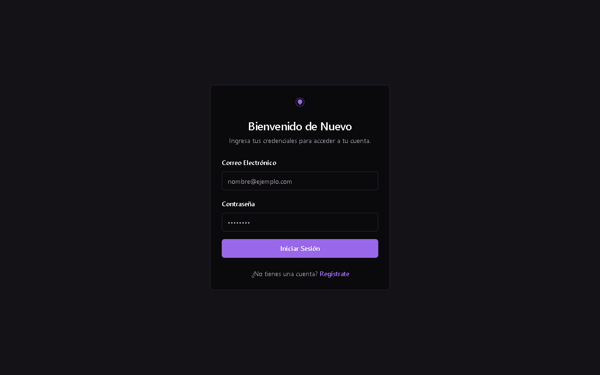
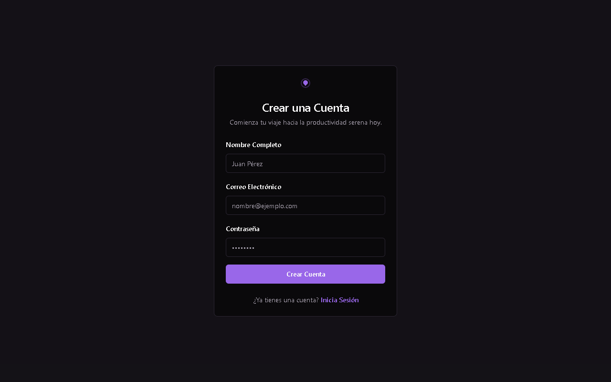
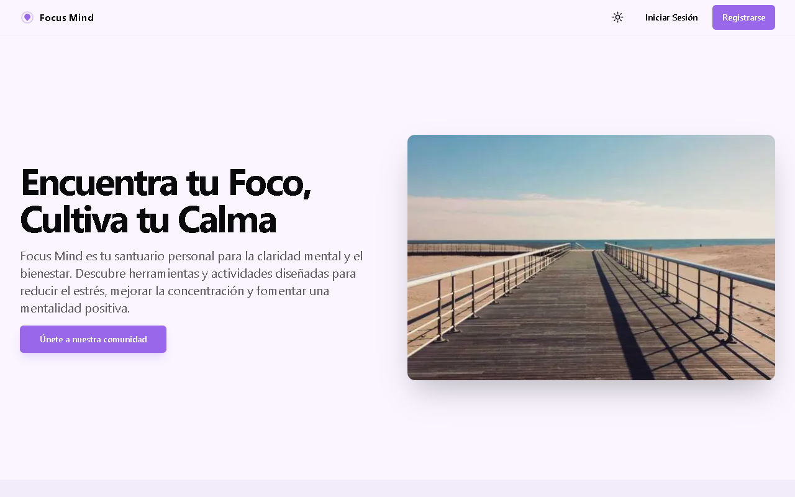

# Focus Mind

Aplicación web de bienestar y productividad: un espacio para concentrarse, relajarse y llevar un registro personal (tareas, calendario, hábitos, diario de gratitud), con actividades de relajación, juegos y contenido generado con IA (Genkit + Gemini). Incluye paneles por rol (administración, supervisión, análisis de datos y gestión de contenido).

Proyecto de grado de Tecnología en Desarrollo de Software, Universidad de San Buenaventura (Colombia).



| Inicio de sesión | Registro | Landing (tema claro) |
|---|---|---|
|  |  |  |

Capturas de las páginas públicas (1280x800). Las pantallas por rol requieren una cuenta de Firebase real y no se incluyen.

## Funcionalidades

Todo lo listado existe en el código; lo que es parcial o está limitado se indica en [Limitaciones](#limitaciones).

### Por rol

| Rol | Rutas | Qué puede hacer |
|---|---|---|
| Usuario (`user`) | `/dashboard`, `/activities` | Lista de enfoque por día, calendario de eventos, check-in diario, todas las actividades |
| Administrador (`admin`) | `/admin`, `/admin/users`, `/admin/events`, `/data-analyst`, `/content-manager`, `/supervisor` | Estadísticas globales, usuarios recientes, editar rol/nombre y eliminar usuarios, ver y eliminar eventos de cualquier usuario, acceso a los demás paneles |
| Supervisor (`supervisor`) | `/supervisor` | Ver los eventos de calendario de todos los usuarios |
| Analista de datos (`data_analyst`) | `/data-analyst` | Conteos globales (usuarios, eventos, tareas, entradas de gratitud, hábitos), gráficos y exportación a Excel |
| Gestor de contenido (`content_manager`) | `/content-manager` | Ver el listado de actividades de la plataforma (solo lectura) |

Todos los roles pueden usar `/dashboard` y `/activities`. Cada ruta de panel comprueba el rol en el cliente y las reglas de Firestore lo comprueban en el servidor.

### Módulos

- **Autenticación**: registro e inicio de sesión con Firebase Auth (correo y contraseña); redirección según el rol.
- **Cifrado de datos del usuario** (`src/lib/crypto.ts`): al iniciar sesión se deriva una clave AES-256 con PBKDF2 (SHA-256, 100 000 iteraciones, sal = correo) a partir de la contraseña; se guarda solo en `sessionStorage` y cifra con AES-GCM (IV aleatorio por mensaje) el texto de tareas, títulos de eventos y entradas de gratitud antes de escribir en Firestore.
- **Lista de enfoque** y **calendario** de eventos por día (Firestore, en tiempo real).
- **Panel de análisis** (`/data-analyst`): conteos agregados, distribución de usuarios por rol, crecimiento de usuarios en el tiempo y exportación de usuarios a `.xlsx` (librería `xlsx`).
- **Actividades** (15): espacio de dibujo, mándala relajante, meditación guiada, juego de memoria, ejercicios de respiración, sonidos relajantes, generador de cuentos, adivina la imagen, diario de gratitud, técnica Pomodoro, afirmaciones positivas, rastreador de hábitos, conecta palabras, puzzle deslizante y lista de enfoque.
- **Flujos de IA con Genkit** (`src/ai/flows`, servidor): `story-flow` (cuento corto), `meditation-flow` (guion con Gemini y audio WAV con el modelo TTS), `image-game-flow` (imagen con Imagen y pista), `word-connect-flow` (palabra aleatoria e interpretación de asociaciones).
- **Tema claro/oscuro** y diseño responsive con shadcn/ui.

## Tecnologías

Next.js 15 (App Router), React 18, TypeScript, Tailwind CSS, shadcn/ui (Radix), Firebase Auth y Firestore, Genkit con `@genkit-ai/google-genai`, React Hook Form + Zod, Recharts, `xlsx`, Vitest. Detalle de cada librería en [docs/TECNOLOGIAS.md](docs/TECNOLOGIAS.md).

## Instalación

Requisitos: Node.js 20 o superior y un proyecto de Firebase con Authentication (correo/contraseña) y Firestore habilitados.

```bash
npm ci
cp .env.example .env.local   # completa los valores (ver abajo)
npm run dev                  # http://localhost:9002
```

### Variables de entorno

Definidas en `.env.example` (los valores nunca se versionan; `.gitignore` excluye `.env*` salvo `.env.example`):

| Variable | Uso |
|---|---|
| `NEXT_PUBLIC_FIREBASE_API_KEY`, `..._AUTH_DOMAIN`, `..._PROJECT_ID`, `..._STORAGE_BUCKET`, `..._MESSAGING_SENDER_ID`, `..._APP_ID` | Configuración web de Firebase (Consola de Firebase > Configuración del proyecto > Tus apps > App web) |
| `GEMINI_API_KEY` | Clave de Google AI Studio para los flujos de IA (solo servidor). Sin ella, la app funciona pero las actividades de IA fallan |

Las variables `NEXT_PUBLIC_*` terminan en el bundle del navegador por diseño de Firebase Web: la protección real son las reglas de Firestore y restringir la API key por dominio en Google Cloud.

### Firestore y primer administrador

1. Despliega las reglas: `firebase deploy --only firestore:rules` (usa `firebase.json` y `firestore.rules`).
2. Cualquier registro nuevo crea una cuenta con rol `user`. Para tener un administrador, cambia a mano el campo `role` de tu documento `users/{uid}` en la consola de Firestore (`admin`, `supervisor`, `data_analyst` o `content_manager`). Desde `/admin/users` un administrador puede cambiar el rol de los demás.
3. Los paneles globales usan consultas `collectionGroup`; si Firestore pide un índice, la consola muestra el enlace para crearlo.

No se incluye una cuenta de prueba pública: crea una propia con `/register`.

## Scripts

| Comando | Descripción |
|---|---|
| `npm run dev` | Servidor de desarrollo (puerto 9002, Turbopack) |
| `npm run build` / `npm start` | Build y servidor de producción |
| `npm run lint` | ESLint (`next/core-web-vitals`) |
| `npm run typecheck` | `tsc --noEmit` |
| `npm test` | Vitest (modo watch); `npx vitest run` para una sola pasada |
| `npm run genkit:dev` | Interfaz de desarrollo de Genkit |

## Estructura

```
src/app/          Rutas (landing, login, register, dashboard, activities, admin, supervisor, data-analyst, content-manager)
src/components/   Componentes de negocio y src/components/ui (shadcn/ui)
src/contexts/     auth-context: sesión, rol y clave de cifrado
src/ai/           Configuración de Genkit y flujos (con sus pruebas)
src/lib/          firebase, crypto, utilidades, manejo de errores de permisos
firestore.rules   Reglas de seguridad de Firestore
docs/             blueprint.md, TECNOLOGIAS.md y capturas
```

## Pruebas

Hay 12 pruebas unitarias con Vitest en `src/ai/flows/*.test.ts`, que cubren los 5 flujos de IA con el modelo simulado (mocks); no hay pruebas de interfaz, de integración ni de las reglas de Firestore. Ejecución: `npx vitest run`.

## Seguridad

- Las reglas de Firestore (`firestore.rules`) leen el rol desde `users/{uid}`; el autoregistro solo puede crear `role: 'user'`, un usuario solo puede cambiar su `name`, y solo un administrador cambia roles o elimina usuarios. Los roles globales (administrador, analista, supervisor) tienen lectura limitada a lo que su panel necesita.
- El selector de rol se eliminó del registro; antes cualquiera podía registrarse como administrador.
- Texto de tareas, eventos y gratitud cifrado en el cliente (ver arriba). El cifrado depende de la contraseña: si se restablece la contraseña, los datos cifrados anteriores no se podrán descifrar.
- Sin secretos en el repositorio; configuración por variables de entorno.

## Limitaciones

- Las reglas de Firestore se revisaron con un linter estático y a mano; no se probaron contra el emulador de Firestore.
- Los hábitos se guardan sin cifrar; solo tareas, títulos de eventos y gratitud van cifrados.
- La sal de PBKDF2 es el correo electrónico (determinista); no hay recuperación de la clave de cifrado.
- El "Check-in diario" del dashboard solo muestra un aviso: no guarda las respuestas.
- `src/ai/flows/focus-list-flow.ts` es una estructura base sin lógica y la interfaz no lo usa.
- La gestión de contenido es de solo lectura (el listado está definido en código).
- Los testimonios de la landing son texto de ejemplo, no opiniones de usuarios reales.
- Las actividades de IA requieren `GEMINI_API_KEY` y consumen cuota del servicio de Google.
